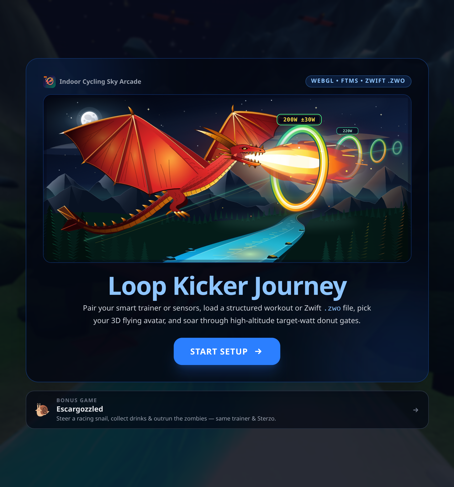
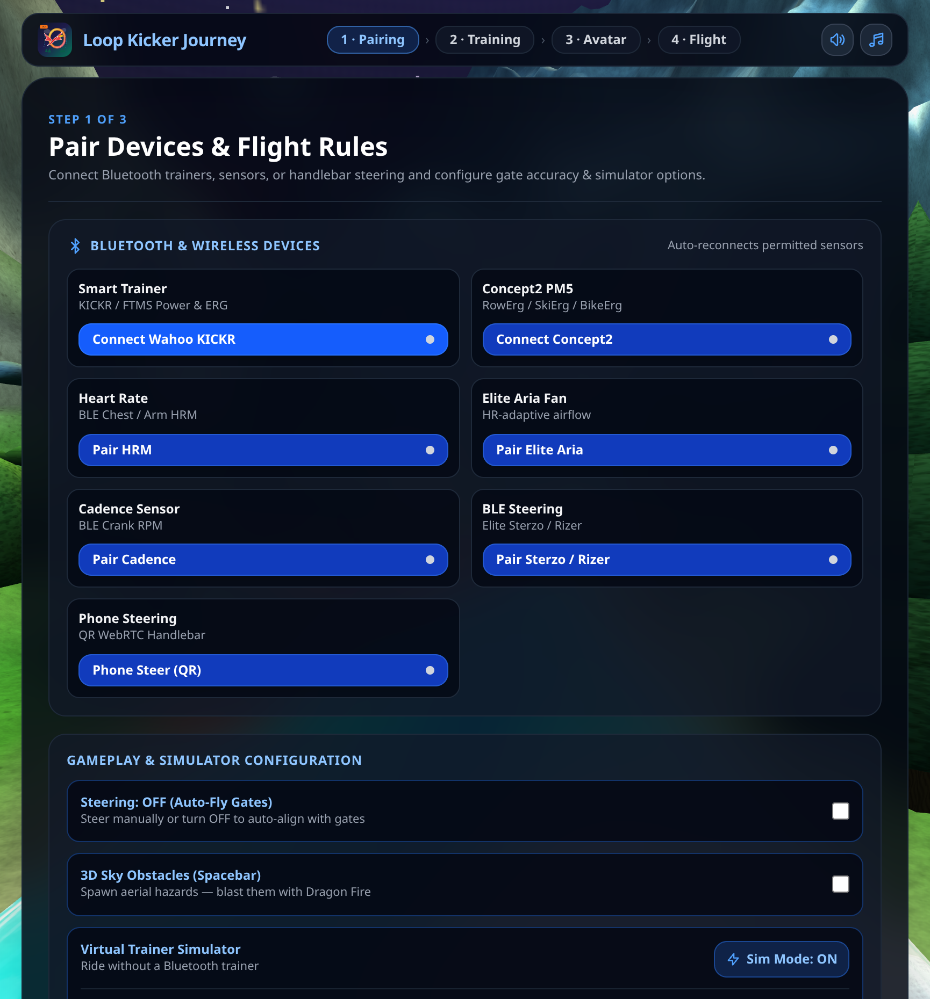
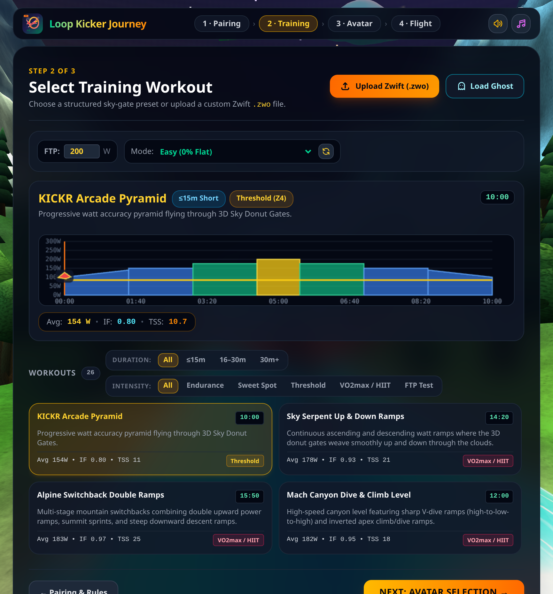
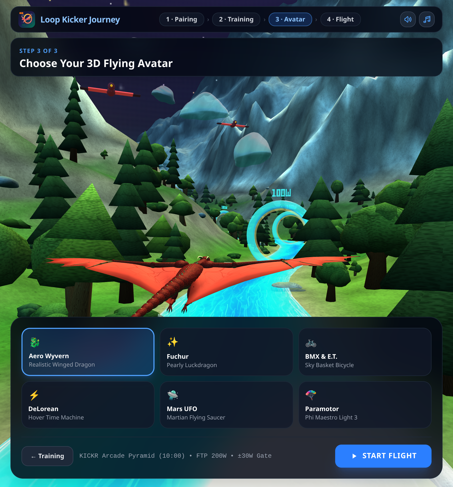
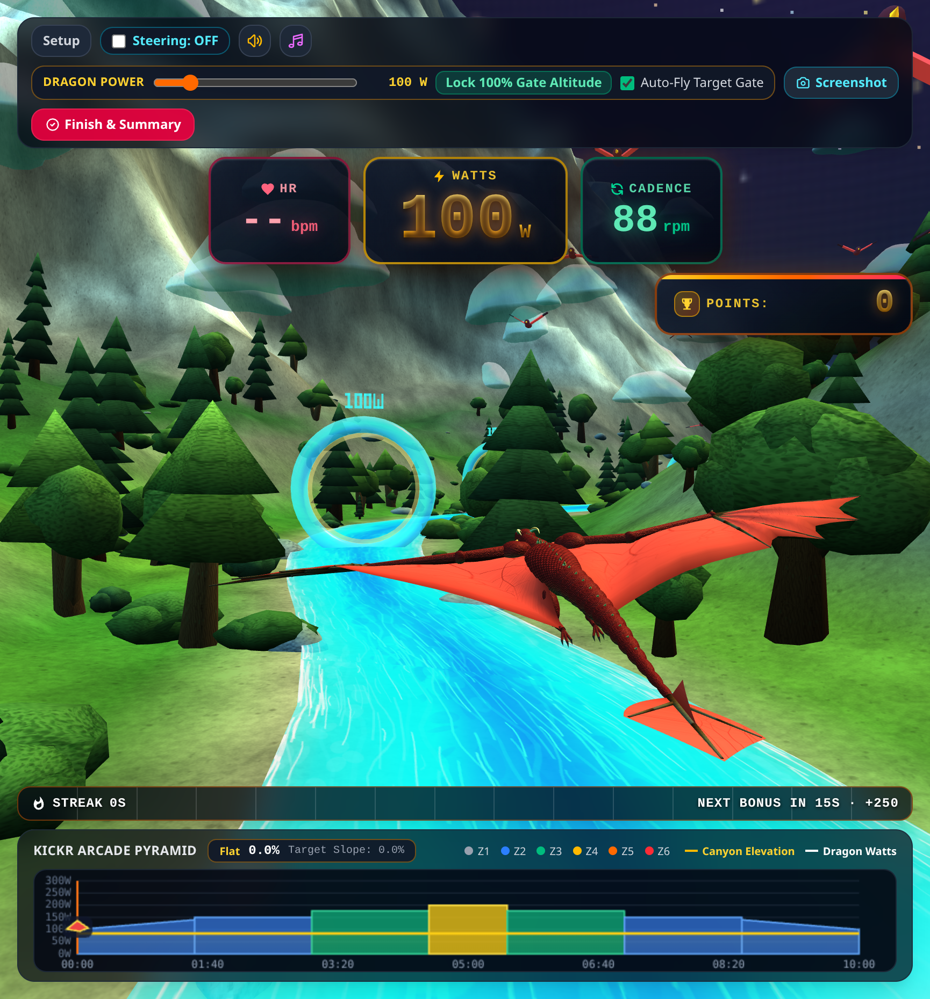
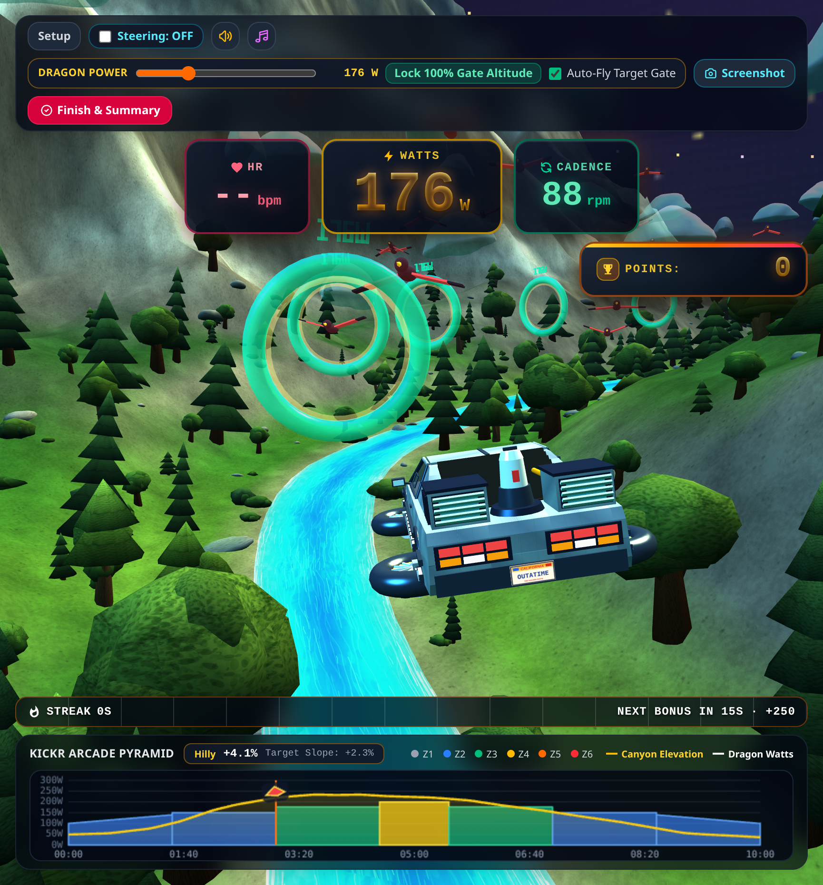
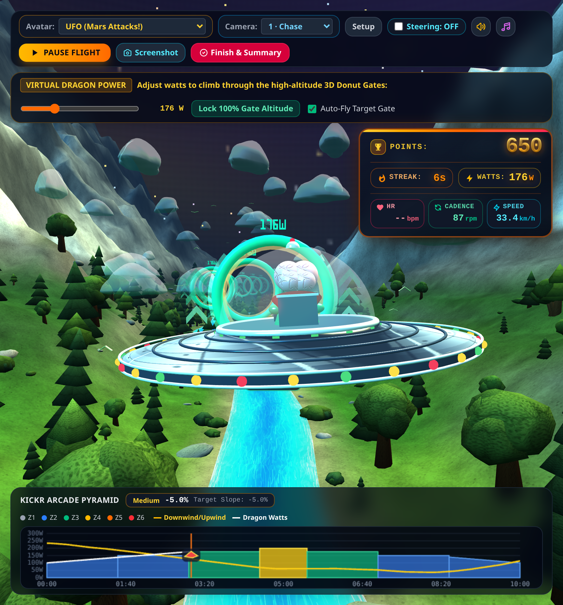
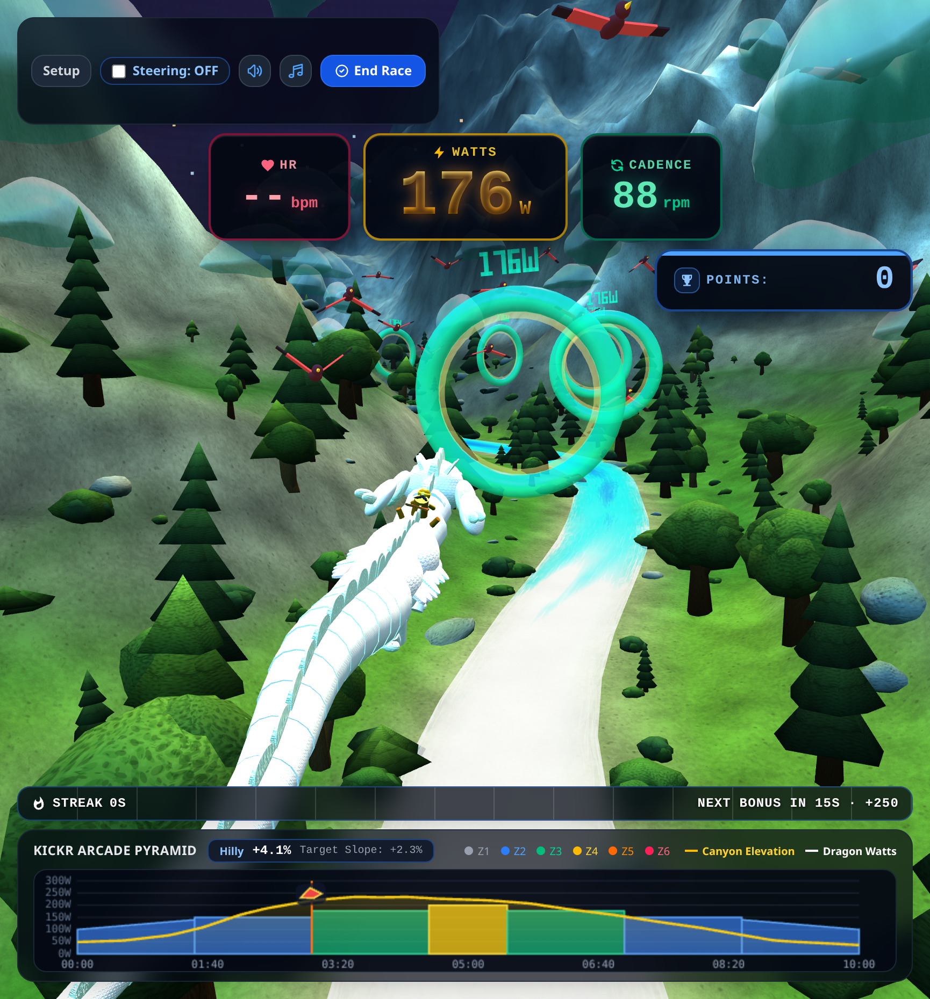
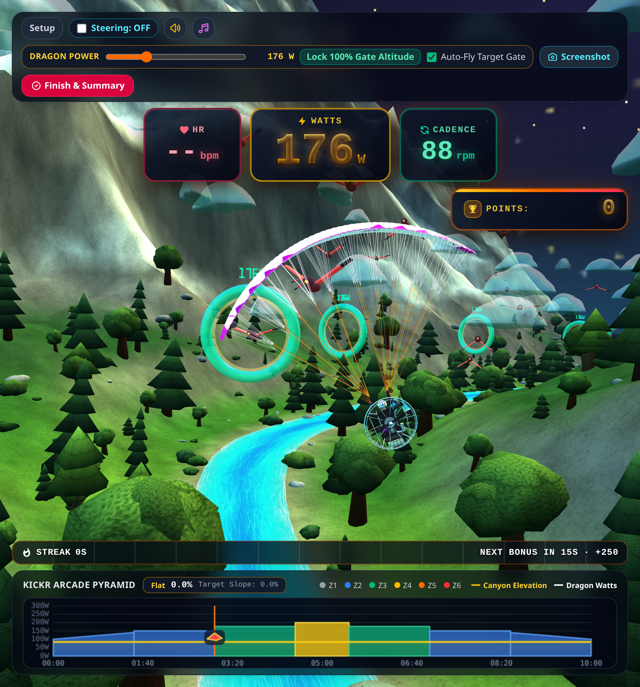
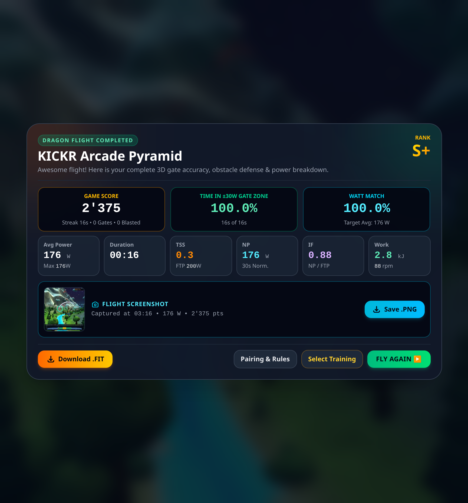

# Loop Kicker Journey

Loop Kicker Journey is a browser-based 3D cycling game for structured indoor cycling workouts. A workout profile sets power targets; power from a connected trainer is measured and its resistance is controlled according to the selected mode. At the same time, an avatar flies through an animated sky filled with donut gates. Optionally, you can shoot obstacles and steer manually.



## Feature Requests

- Multiplay
- Ranking server

## Quick start

No server or package installation is required. The page loads Three.js and Tailwind CSS at runtime from CDNs, so an internet connection is required.

1. Clone or download the repository.
2. Open `index.html` directly in Chrome or another browser that supports Web Bluetooth.
3. Step through the setup screens and take off:
   - **Splashscreen:** Click **Start Setup** from the dragon hero screen.
   - **1 · Pairing & Rules:** Pair Bluetooth devices (or enable the Virtual Trainer Simulator and **Auto-Fly Target Gate**) and configure steering and 3D obstacles.
   - **2 · Training Selection:** Filter the 26 built-in presets by duration (`≤15m`, `16–30m`, `30m+`) and intensity (`Endurance`, `Sweet Spot`, `Threshold`, `VO2max / HIIT`, `FTP Test`) or upload a Zwift `.zwo` file, then set your FTP, preview expected **Avg** watts / **IF** / **TSS**, and choose a resistance/slope mode. With `server.js`, the best scores of the selected workout are shown below its preview, and you can optionally pick one to race it as ghost (see [Ghost rides](#ghost-battle)).
   - **3 · Avatar Selection:** Choose your 3D avatar over a live sky preview, then click **Start Flight** to trigger a 3-second pre-flight countdown (`3–2–1–GO!`) with audio cues.
   - **4 · Flight & Summary:** Fly through the target-watt donut gates and finish to view the **Workout Summary** screen (`.fit` and `.png` export; with `server.js` also **Save** of your score & ghost ride under your name).

Simulation mode is enabled by default, so you can try the game without a trainer. Bluetooth requires a compatible browser; the Web Bluetooth API is supported by browsers such as current versions of Chrome and Edge. Bluetooth is available only in a secure context (for example, `localhost` or HTTPS).

For an HTTPS deployment behind a reverse proxy, set `APP_ORIGIN` to the public origin in the server environment.

### Docker

`server.js` serves the whole game, Escargozzled, and both APIs, so a single container is enough:

```bash
docker build -t loop-kicker-journey .
docker run -d -p 8000:8000 -v loop-kicker-journey-data:/data loop-kicker-journey
```

Then open `http://localhost:8000`. Ghost rides and highscores are stored in `/data` (`GHOSTRIDES_DIR=/data/ghostrides`, `LOOP_KICKER_SCORES_FILE=/data/loop-kicker-journey-scores.json`, `ESCARGOZZLED_SCORES_FILE=/data/scores.json`), either as a named volume or as a mounted host folder. On every start, [`docker-start.sh`](docker-start.sh) copies the ghost rides bundled in `data/ghostrides/` into `GHOSTRIDES_DIR` without overwriting existing files. The container runs as user `node` (UID 1000), so a mounted host folder must be writable for it (for example `chown -R 1000:1000 <host folder>`); otherwise the log shows a warning and highscores cannot be saved. To use Bluetooth from other devices, put an HTTPS reverse proxy in front of the container and set `APP_ORIGIN` (for example `-e APP_ORIGIN=https://loop.example.com`).

## Gameplay and workout controls

Your current power is compared with the workout's target power. The game displays power accuracy, workout intervals, and progress in the HUD; watts, heart rate, and cadence are shown large at the top center, points (and the comparison with a loaded ghost ride) at the top right. Clearing consecutive donut gates in-zone builds your combo multiplier and awards tiered **Ring Streak** bonuses every 15 rings (`+250` points per tier, from *Nice Streak!* to *Legendary!*) with visual splash banners and ascending arpeggios. A full-width streak bar above the timeline fills up ring by ring until the next bonus. FTP (200 W by default; adjustable from 50 to 600 W) is used to calculate power targets specified as a percentage of FTP. Donut gate size and allowed power deviation are fixed at `±30 W`.

Available workouts can be filtered by duration and physiological intensity:

- **Arcade & Ramp Challenges:** **KICKR Arcade Pyramid**, **Quick 3-Minute Accuracy Sprint**, **Sky Serpent Up & Down Ramps**, **Alpine Switchback Double Ramps**, **Mach Canyon Dive & Climb Level**, **Dragon Boss Mega-Ramp Gauntlet**, **Dragon Canyon Rollercoaster**, and **Alpine Sawtooth Multi-Peak**
- **Physiologically Structured Workouts:** **Active Recovery Flush (Z1)**, **Mitochondrial Zone 2 Base**, **Polarized LT1 Aerobic Cruiser**, **2×12m Sweet Spot Builder**, **Muscular Force Tempo (SE)**, **MCT1 Lactate Shuttle Over-Unders**, **2×15m MLSS Threshold Cruise**, **Rønnestad 30/15 VO2max Blocks**, **Norwegian 4×4m VO2max Cardiac**, and **Billat Fast-Start VO2 Kinetics**
- **HIIT & Race Simulations:** **30/15 VO2max Micro-Burst Storm**, **Dragon Fire Tabata Inferno**, **Over-Under Surge Blitz**, **Harmonic Wave & Step Matrix**, **Sweet Spot Precision**, and **Pro Criterium Corner Sprints**
- **FTP Ramp Tests:** **Standard MAP / FTP Ramp Test** (`+20 W/min` up to `580 W`) and **Lite / Finer-Step FTP Ramp Test (+10W)** (`+10 W/min` up to `560 W`) — progressive 1-minute fixed-watt ramps ridden to exhaustion, estimating FTP values past `400 W` regardless of your prior FTP setting. During an FTP test, the canyon flies straight, birds/obstacles are disabled, and an active FTP Test badge is shown in the HUD. Stopping pedaling (`0 W`) shows a 5-second auto-stop countdown inside the pause overlay before automatically finishing the flight, displaying your calculated FTP (`75%` of best 1-minute average power) prominently in the summary, and saving it to `localStorage` as your default FTP for future trainings.
- **Custom Zwift workouts** in `.zwo` format

Resistance modes are **Flat** (`0%` flat), **Hilly** (rolling hills), and **ERG Lock**. In **Hilly** mode, the random 3D canyon terrain is generated once per workout so it stays the same whenever the same workout is ridden again, and the canyon floor, river, forest, and flight path physically climb and descend along the terrain elevation profile. Your watts only set the dragon's altitude; its forward speed is fixed and only changes with the terrain: it flies slower uphill and faster downhill, and the 3D distance between donut gates scales with that speed. Flight pauses whenever `0 W` are generated. During a flight, **Setup** pauses the workout and returning to the flight resumes it; **Finish & Summary** ends a workout early. The avatar can only be changed in setup.

### Adaptive music

While flying, a procedurally generated soundtrack (Web Audio, no audio files) follows the target power of the next ring (donut gate) ahead, relative to FTP. Your actual pedaled watts do not affect it, so the music tracks the workout's intervals. Tempo, key, instruments, and brightness change with the ring targets:

| Mood | Ring target (% FTP) | Sound |
| --- | --- | --- |
| **Drift** | < 35 % | 76 BPM, soft major pads and sparse bells, no drums |
| **Cruise** | 35–68 % (warm-up/cool-down) | 92 BPM, warm pads, soft kick, gentle arpeggio |
| **Groove** | 68–90 % | 112 BPM, groove beat, plucked bass, 8th-note arpeggio |
| **Drive** | 90–106 % | 128 BPM, minor key, four-on-the-floor, saw bass, 16th-note arpeggio |
| **Inferno** | > 106 % | 146 BPM, full drums with fills, rolling bass, sawtooth lead |

Transitions are smoothed so short target changes don't toggle the music. The music (note) button in the header turns the soundtrack on or off. The speaker button mutes all audio, including the music; while muted, the music button is disabled.

## Controls

| Key | Action |
| --- | --- |
| `←` / `A` | Steer left |
| `→` / `D` | Steer right |
| `Space` | Breathe dragon fire to fend off obstacles |
| `↑` / `↓` | Increase/decrease power by 10 W in simulation mode |
| `Shift` + `↑` / `↓` | Increase/decrease power by 25 W in simulation mode |

You can turn off manual steering to have the avatar automatically steer through the gates. Obstacles can be enabled or disabled with the corresponding option. Watch out for the red birds flying towards you: colliding with one costs 200 points (bird strike).

## Avatars

Available avatars:

- Aero Wyvern
- Fuchur
- Boy with Bicycle & E.T.
- DeLorean
- UFO
- Paramotor (pilot with a caged propeller under a white/lilac Phi Maestro Light 3 paraglider)

The camera always follows your avatar from behind. Your avatar, FTP, steering, and accuracy settings are saved in the browser.

## Connecting trainers and sensors

Use the BLE buttons to pair supported devices:

- Wahoo KICKR (power and trainer control)
- Concept2 RowErg, SkiErg, or BikeErg via the PM5 monitor (power, stroke rate shown as cadence, and heart rate from a strap paired to the PM5). The PM5 cannot be controlled, so resistance modes and ERG Lock have no effect; you set the effort yourself.
- Heart rate monitors
- Cadence sensors
- Elite Sterzo Smart or Elite Rizer (BLE steering)
- Mobile phone handlebar steering via QR code (WebRTC peer-to-peer): Click **Phone Steer (QR)** on the desktop to display a QR code. Scanning it on your phone opens a minimalistic mobile steering controller page (`?phone-steer=<id>`) with sensor permission handling, live angle gauge, **Calibrate Center (0°)**, axis inversion, touch test slider, and a **Dragon Fire** button—without requiring `server.js` or typing IP addresses.
- Elite Aria Smart Fan

Bluetooth devices must be powered on and within range. Start pairing from the corresponding control in the interface. Without a trainer, use simulation mode; power can be adjusted with the slider or arrow keys.

### Automatic reconnection

Previously paired Bluetooth devices reconnect automatically when the page loads and whenever they come back into range. This uses the Web Bluetooth `getDevices()` API, which is enabled by default only from Chrome 169. In earlier Chrome or Edge versions, enable it manually:

1. Open `chrome://flags/#enable-web-bluetooth-new-permissions-backend` (in Edge: `edge://flags/#enable-web-bluetooth-new-permissions-backend`).
2. Set the flag to **Enabled** and restart the browser.
3. Pair each device once more using its button so that the browser remembers the permission.

Without this flag, devices must be paired manually after every page load. Messages prefixed with `[BLE auto-connect]` in the browser console show which devices were found and whether a connection succeeded.

## Custom workouts and results

- **Load a Zwift workout:** Select a `.zwo` file using **Upload Zwift (.zwo)**. Supported interval types include SteadyState, Warmup, Cooldown, Ramp, IntervalsT, FreeRide, and MaxEffort (plus `<ftpTest>true</ftpTest>` or "Ramp Test" / "FTP Test" in `<name>` for custom FTP tests).
- **Save a FIT file:** After the workout, review your rank, gate accuracy, and power metrics (**Avg Power**, **TSS**, **NP**, **IF**, **Work**), then click **Download .FIT** to export the recorded activity for Strava, Garmin Connect, or another training platform.
- **Garmin Connect:** Direct activity uploads require access to Garmin's Business Developer Program Activity API, which provides push access. Garmin's personal API access is pull-only. Until business access is available, download the FIT file and import it into Garmin Connect manually.
- **Save a screenshot:** An in-game screenshot (including the HUD and bottom workout timeline overlay) is captured automatically at the end of a flight or anytime via **Screenshot**, and can be downloaded from the summary via **Save .PNG**.
- **Ghost rides:** Saving a ride in the summary (see [Saving score & ghost](#saving-score-ghost)) stores it as a `.loop-kicker-journey-ghost.json` file. The file contains the workout, the resistance **Mode** (**Flat**, **Hilly**, or **ERG Lock**, plus the terrain profile for **Hilly**), and your watts and score for every second. Loading a ghost restores the workout and Mode (locking the mode selector while the ghost is loaded) and replays the recorded terrain, so you race through the same rings. Older ghost files may contain an accuracy setting, but it is ignored; ring size is always fixed at `±30 W`. A translucent cyan copy of your avatar flies beside you. Everyone flies at the same forward speed, so it stays one second (one ring) ahead of you; watts only change its flight altitude. The HUD shows the ghost's watts and your score difference, and the summary reports who won.
- <a id="ghost-battle"></a>**Ghost Battle:** Put ghost ride files into `data/ghostrides/` and run `node server.js` (set `GHOSTRIDES_DIR` to use a different folder). When you select a workout on the **Training Selection** screen (**Step 2**), a **Best Scores & Ghost Rides** panel below the workout preview shows its best 3 rides per Mode, each with the rider's name, score, date, duration, FTP, and avatar. Racing a ghost is optional: click a ride to load it as ghost together with its FTP, Mode, and wind course; click it again or click **Ride without ghost** to remove it. Then choose your avatar in **Step 3** and click **Start Flight**; the ghost flies as a copy of the avatar you pick. The ghost's FTP is used only while the ghost is selected, so your saved FTP stays unchanged and is restored when you remove the ghost. Without `server.js` (for example via `file://`), the panel stays hidden.
- <a id="saving-score-ghost"></a>**Saving score & ghost:** With `server.js`, the summary shows at the top your score and a **Your Name** field for every ride, including rides ended early with **End Race** (their shorter ride simply scores fewer points). Click **Save** to store the ride under that name (remembered in the browser for next time): the ghost file goes into `data/ghostrides/` (named `<workout>_<mode>_<date>_<time>.loop-kicker-journey-ghost.json`), so it appears right away in the **Best Scores & Ghost Rides** panel of that workout, and the score is added to `data/loop-kicker-journey-scores.json` (set `LOOP_KICKER_SCORES_FILE` to use a different file). Scores are ranked separately per selected workout (preset key, or a hash of an uploaded `.zwo`) and terrain **Mode** (Flat, Hilly, ERG Lock); the avatar does not matter. Already before saving, the summary shows in large type the rank your score gets in that category (medal for the top 3), e.g. *🥈 Rank #2 of 5*, next to the current top 3 with names and scores. After **Save**, the name field disappears and the top 3 is refreshed, with your entry highlighted if you made it.

## Screenshots

| View | Screenshot |
| --- | --- |
| Splashscreen |  |
| Step 1 · Pairing & Rules |  |
| Step 2 · Training Selection |  |
| Step 3 · Avatar Selection |  |
| Flight |  |
| DeLorean avatar |  |
| UFO avatar |  |
| Fuchur avatar |  |
| Paramotor avatar |  |
| Workout summary |  |

## Project files

- [`index.html`](index.html) – Page markup (screens, HUD, modals) and the ordered list of scripts
- [`css/styles.css`](css/styles.css) – Custom animations and styles (Tailwind utility classes are used inline)
- [`js/`](js/) – Application code as plain browser scripts (no build step). They share one global scope and are loaded in this order by `index.html`:
  - [`mobile-controller.js`](js/mobile-controller.js) – Standalone phone steering controller (`?phone-steer=<id>`)
  - [`workouts.js`](js/workouts.js) – Preset workouts and Zwift `.zwo` parser
  - [`fit-encoder.js`](js/fit-encoder.js) – Binary `.fit` file export
  - [`audio-synth.js`](js/audio-synth.js) / [`music.js`](js/music.js) – Sound effects and adaptive procedural music
  - [`bluetooth.js`](js/bluetooth.js) – Web Bluetooth trainer, heart rate, speed/cadence, and steering devices
  - [`particles.js`](js/particles.js) – Particle and overlay effects
  - [`game-state.js`](js/game-state.js) – Main game state and scoring logic
  - [`dragon-sky-3d.js`](js/dragon-sky-3d.js) – Three.js world, gates, obstacles, and avatars (`DragonSky3DEngine`)
  - [`scoring-timeline.js`](js/scoring-timeline.js) – Scoring helpers and timeline canvas
  - [`hud.js`](js/hud.js) – Live HUD and 1 Hz workout tick
  - [`ghost-rides.js`](js/ghost-rides.js) – Saving and racing ghost rides
  - [`main.js`](js/main.js) – Event listeners and initialization (must stay last)
- [`server.js`](server.js) – Local static web server, ghost ride API for the **Best Scores & Ghost Rides** panel (`/api/ghostrides`, reads `data/ghostrides/`; `POST` saves a finished ride as ghost file and highscore), the Loop Kicker Journey highscore API (`/api/loop-kicker-journey/scores?workoutKey=…&resistanceMode=…[&score=…]`, with `score` it also returns the rank a ride with that score would get; reads `data/loop-kicker-journey-scores.json`), and the Escargozzled highscore API (`/api/escargozzled/scores`, writes `escargozzled/scores.json`; set `ESCARGOZZLED_SCORES_FILE` to use a different file)
- [`escargozzled/`](escargozzled/) – **Escargozzled**, a small WebGL bonus game (racing snail, Avanti watts & Sterzo steering), linked below the main card on the splashscreen and served at `/escargozzled/`. It shares the Three.js build, [`sensordata/sterzo-challenge-codes.js`](sensordata/sterzo-challenge-codes.js), and `server.js` with Loop Kicker Journey; see its [README](escargozzled/README.md)
- [`loop-kicker-journey-models.js`](loop-kicker-journey-models.js) – 3D models
- [`sensordata/sterzo-challenge-codes.js`](sensordata/sterzo-challenge-codes.js) – Sterzo challenge/response table (also used by Escargozzled); the source code attributes it to `pycycling` under the MIT license
- [`loop-kicker-journey.svg`](loop-kicker-journey.svg) – Logo and favicon
- [`docs/screenshots/`](docs/screenshots/) – Documentation screenshots
